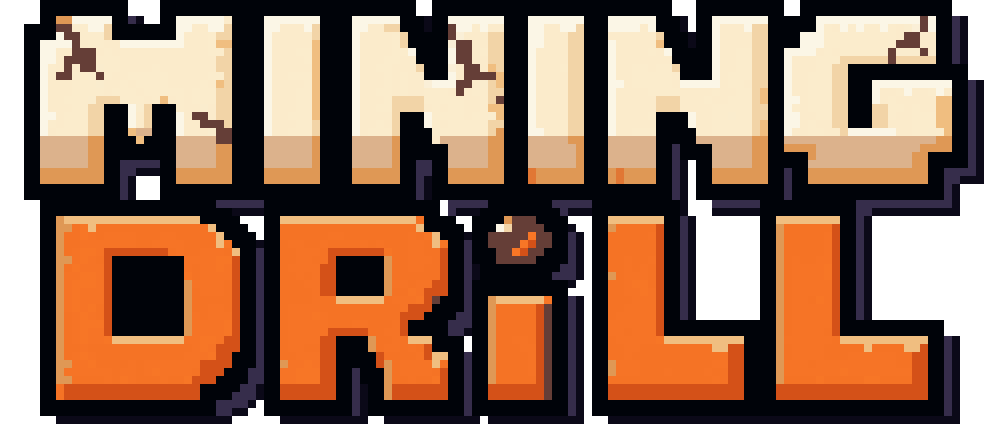
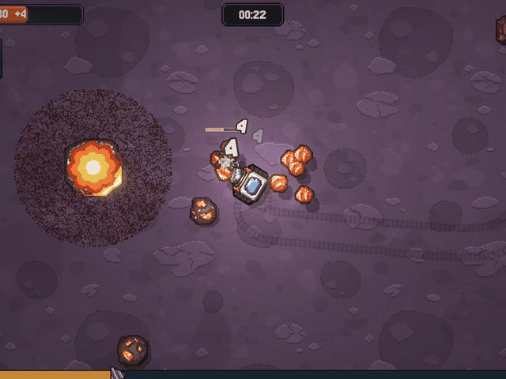
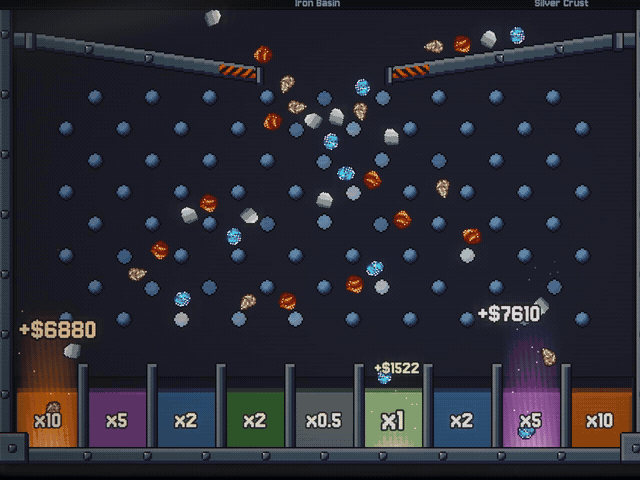
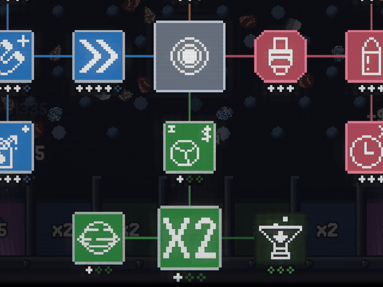
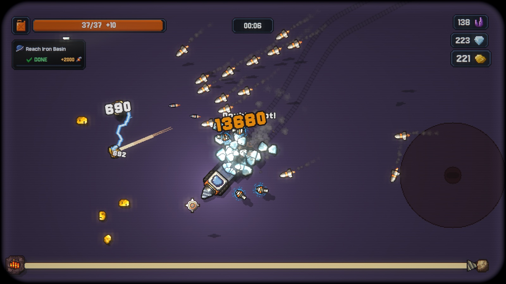
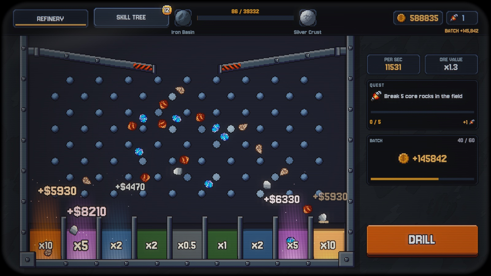
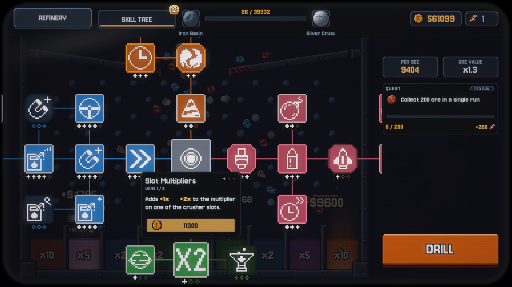
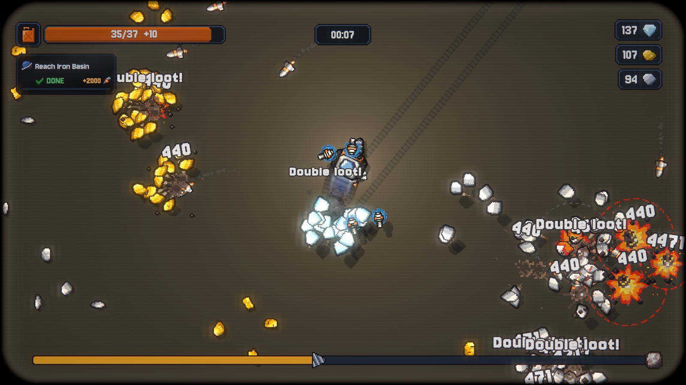

  

<b>Mine. Refine. Upgrade.</b> 
Start with one small drill. End with a missile swarm tearing through planets of ore.

**Role:** Core Developer at Empty Hat, a team of 3
**Period:** June 2026 – present
**Genre:** incremental pixel-art mining game for PC and Mac (Steam)
**Links:** [Trailer](https://www.youtube.com/watch?v=PqTlENSS5jA) · [YouTube channel](https://www.youtube.com/@EmptyHatGames) · [emptyhat.games](https://emptyhat.games/)

  
  
  

## Core loop
Drive a drill rig until the fuel runs out. The drill, guns and missiles break rock. The ore drops through a **plinko refinery** with multiplier slots up to x10 and turns into money. Spend it in the **skill tree** and start the next run. There are 5 planets, monoliths, quests and a final ending.

## Tech
Unity 6 · URP · **Entitas ECS** (Jenny codegen) · Zenject · UniTask · Addressables · DOTween · Animancer · NUnit + FluentAssertions + NSubstitute · Python/numpy · DaVinci Resolve scripting

Architecture: three layers (View / Domain / Storage), requests and events as entities, reactive queries for UI, a game state machine, and snapshot-based save/load.

## What I built
I worked across the whole game: core systems, features, visuals, balance, builds and marketing. About 200 commits.

### Gameplay
- **Plinko refinery minigame, end to end.** Ore pours into a hopper, bounces off pins and lands in multiplier slots. It has anti-jam physics, skill-driven pin loot that pays once per stone and pin and survives save/load, a salvage chute, and a live earn rate.
- **Deterministic procedural world.** Chunk-based ore generation streamed around the player, reproducible from a seed. Includes clusters ("veins"), scattered rocks, core rocks, per-planet density profiles and visual culling of far chunks.
- Quest system (about 20 tracking systems, claim flow, final survey ending), core-rock loot skills, multi-source fuel, monolith HP curve, income service with ramp profiles.

### Visuals and feel
- Retro **CRT post-process** as a URP renderer feature with presets.
- 2D drop, inner and airborne **sprite shadows**.
- Floating damage text with easing presets, plus UI animation and sound polish.

### Data-driven balance
- **Telemetry:** about 30 ECS recorder systems write per-run CSVs (damage, loot, fuel, frame time, weapon target starvation).
- **Autopilot bot:** buys real skill routes and plays the game in batch runs.
- **Python progression model:** Monte Carlo seed sweeps, up to 20,000 simulated runs per balance candidate, with machine-checked pacing contracts.
- **Balance importer:** validated JSON → Unity assets, applied atomically.
- **Pre-build gate:** every Player build runs the EditMode test suite (158 checks). Release builds also need an accepted balance import.
- Automated frame benchmark on Player builds: p95 frame time 17.3–17.5 ms at the 60 FPS cap.

### Production
- **One-command video pipeline:** the autopilot records takes from a shot list, DaVinci Resolve builds the timeline from a cut list via scripting, then render and ffprobe verification.
- Produced the trailers, Steam screenshots and GIFs, a publisher pitch deck, and macOS/Windows publisher builds with Full, Demo, Publisher and Kiosk profiles.

## Code samples
Real code from the project, written by me.

| File | What it shows |
|---|---|
| [ChunkGenerator.cs](code-samples/ChunkGenerator.cs) | Deterministic chunk generation: weighted tables, clusters, stochastic rounding seeded by chunk key |
| [RefineryPinLootService.cs](code-samples/RefineryPinLootService.cs) | Pin loot that pays once per stone/pin pair, survives save/load and emits an ECS event |
| [SalvageStoneInWeakSlotSystem.cs](code-samples/SalvageStoneInWeakSlotSystem.cs) | Stateless Entitas system driven by matchers and flag components |
| [IncomeService.cs](code-samples/IncomeService.cs) | Income scaling with fractional carry and saturating math |

## Screenshots

  
  
  
  

---
Egor Babaev · [LinkedIn](https://www.linkedin.com/in/egor-babaev/) · babaev1302@gmail.com
